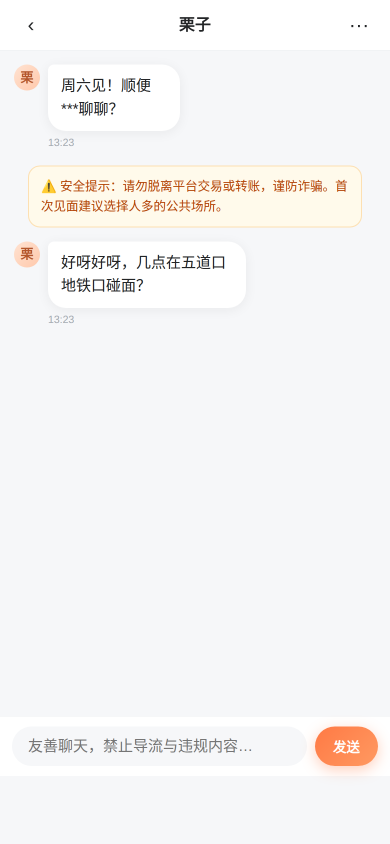
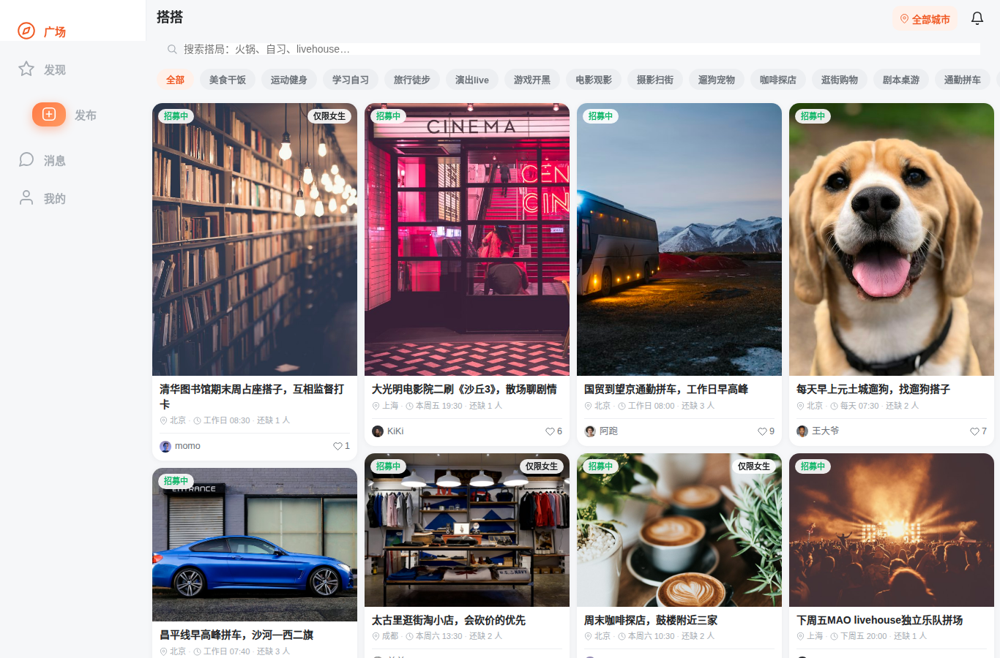
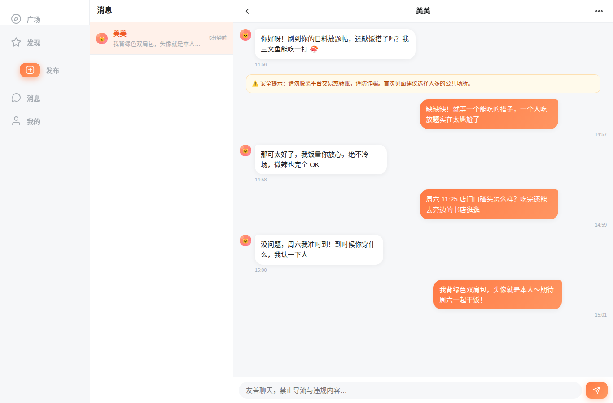
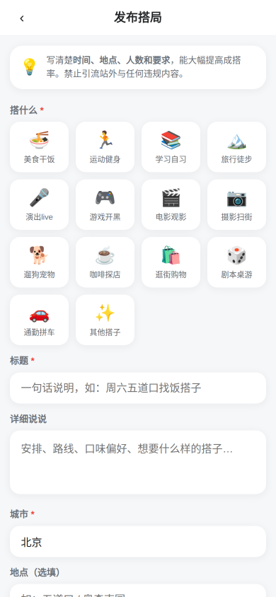
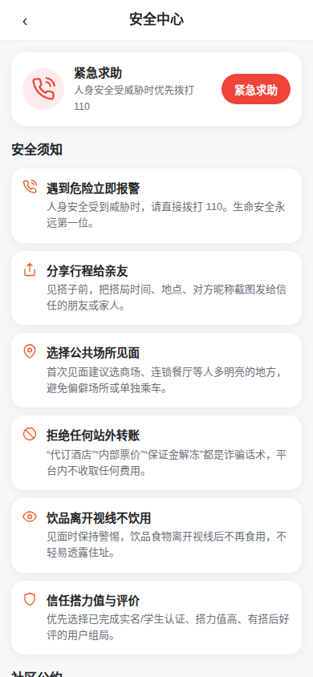
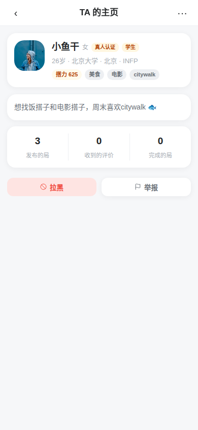

# 搭搭 🤝

> 万物皆可搭，找人别犯难 —— 一个专注于"找搭子"的轻社交 App（H5 · PWA · 桌面网页 · 可打包App）

**H5 移动端**（对标小红书：双列瀑布流 / 大图轮播 / 底部操作栏）：

| 广场·瀑布流 | 搭局详情·轮播 | 聊天（安全提示+导流打码） | 我的（三栏数据+网格） |
|---|---|---|---|
|  |  |  |  |

**桌面网页端**（侧边栏 + 多列瀑布流 + 聊天左右分栏）：

| 桌面广场·4列 | 桌面聊天·分栏 |
|---|---|
|  |  |

| 发布（可传图） | 发现推荐 | 安全中心 | 个人主页 |
|---|---|---|---|
|  |  |  |  |

**搭搭**是一个解决"找搭子"需求的完整产品：饭搭、学习搭、运动搭、旅行搭、游戏搭……发布搭局、申请加入、站内聊天、搭后互评，全流程闭环。针对搭子赛道普遍存在的**微信黑洞、人性衰退、女性安全、诈骗导流**四大顽疾做了系统性设计（详见 `docs/research.md`）。

## ✨ 核心特性

| 模块 | 说明 |
|---|---|
| 🧭 搭局广场 | 14 类场景分类、城市/关键词/性别筛选、最新/热门排序，游客可直接浏览 |
| ✨ 智能发现 | "为你而设"（基于历史参加分类+兴趣标签重合推荐）+ 热门搭局 |
| ➕ 发布搭局 | 时间/地点/人数/AA方式/性别要求/其他要求，敏感词与涉黄暗语自动拦截 |
| 🙋 组局审批 | 申请→组局者查看资料审批→满员自动关闭→标记完成 |
| 💬 站内聊天 | WebSocket 实时收发、私信门槛（需先同局）、导流词自动打码、首条消息安全提示 |
| ⭐ 搭后互评 | 1-5星+标签词（守时/靠谱/友善…），互评沉淀为公开的搭子履历 |
| ⚡ 搭力值 | 信用体系：认证/完成搭局/好评加分，爽约/被举报扣分，<300 禁发布 |
| 🛡️ 安全中心 | 反诈须知、社区公约、SOS紧急求助直达管理员、一键拉黑 |
| ♀ 女性保护 | 仅限女生局（发帖可选+申请强制校验性别）、女性安全入口 |
| 📊 运营后台 | 数据看板、举报队列（警告/封禁/下架/驳回）、用户管理 |

## 🚀 快速开始

```bash
git clone https://github.com/Jensen-Yao/dada.git
cd dada
./start.sh
```

打开 `http://localhost:3000`（手机浏览器访问 `http://<局域网IP>:3000` 体验完整移动端 App）。

**演示账号**

| 角色 | 账号 | 密码 | 说明 |
|---|---|---|---|
| 普通用户 | `xiaoyu` | `123456` | 已认证，有搭局/评价数据 |
| 管理员 | `admin` | `123456` | 可访问运营后台 |

也可以直接注册新账号（演示环境认证一键通过）。

## 🧱 技术架构

```
dada/
├── server/                # Node.js 后端（零原生依赖）
│   ├── src/
│   │   ├── index.js       # Express + WebSocket 入口
│   │   ├── db.js          # node:sqlite（Node 22.5+ 内置，无需安装数据库）
│   │   ├── util.js        # JWT/敏感词/搭力值/通知
│   │   ├── seed.js        # 演示数据（10用户12搭局）
│   │   └── routes/        # auth/users/posts/chat/admin/safety/misc
│   └── test/api.test.js   # 23 个 API 测试（node --test）
├── web/public/            # 前端（原生JS单页应用，零构建）
│   ├── index.html
│   ├── css/app.css        # 移动端App设计体系
│   └── js/                # api/ui/ws/app + 12个页面模块
├── docs/research.md       # 产品调研（QYUE复盘洞察+赛道方案）
└── scripts/               # 截图/验证脚本
```

**技术选型理由**：Node 内置 SQLite + 原生JS零构建，单机零外部依赖部署，复制即跑——对应独立开发者"低成本验证需求"的核心诉求。

```bash
# 运行测试
cd server && npm test          # 23 个 API 测试

# 重置演示数据
rm server/data/dada.sqlite* && cd server && node src/seed.js
```

## 🛡️ 针对赛道顽疾的产品设计

| 顽疾 | 搭搭的应对 |
|---|---|
| **微信黑洞**（约上就流失站外） | 聊天自动过滤"加微信/VX"；搭后互评+搭力值闭环必须回App完成，信用离开平台即失效；搭子履历沉淀在个人主页 |
| **人性衰退**（约炮化/骚扰） | 私信门槛（先同局再私聊）；涉黄暗语词库（"费用全包"等）；搭力值<300禁发布；3次违规自动封号 |
| **女性安全** | 仅限女生局；SOS紧急求助直达管理员；一键拉黑即时生效 |
| **诈骗导流** | 转账/代订/保证金词库拦截；首条消息安全提示；安全中心反诈教育 |

## 📖 背景：从戚越QYUE的近百万学费中学到什么

本项目参考了B站UP主**戚越QYUE**《我花了近百万，做了一款专门找搭子的APP》的复盘（BV1HH4y1c7E4）及836条高赞评论的核心洞察，完整分析见 `docs/research.md`：

1. **先验证再开发**（293赞）→ 搭搭做成零安装H5，二维码一扫即可验证需求
2. **微信黑洞**（43赞）→ 搭后互评+搭力值社交货币，把关系留在站内
3. **人性问题**（297赞）→ 私信门槛+暗语拦截+女性保护+运营后台的组合拳

## 🗺️ 迭代路线

详见 `docs/roadmap.md`。当前 v1.0 已完成MVP全功能闭环，后续规划：真实身份核验接入、LBS距离排序、搭局群聊、AI违规检测、小程序/原生端。

## 📱 多端打包指南（PWA + Capacitor）

> ⚠️ capacitor.config.json 的 server.url 当前为占位域名，真机打包前请改为你的部署地址；本地演示改为 http://<局域网IP>:3000

搭搭 v2.0 是"一套代码，三端形态"：H5（主战场）→ PWA（可安装）→ Capacitor 原生壳（近原生）。三端共用 `web/public` 下的同一份零构建前端（C1 约束），不引入前端构建链。

### 1. PWA 安装（零成本，推荐先验证）

服务端已内置 `manifest.json` + Service Worker（`sw.js`），满足可安装条件：

- 访问方式：手机浏览器打开 `https://<域名>/`（或本机 `http://localhost:3000`）
- **Android Chrome**：地址栏右侧出现「安装」图标，或页面底部弹出「安装搭搭到桌面」横幅（可关闭，关闭后记录在 localStorage 不再提示）→ 点击安装，桌面生成独立图标
- **iOS Safari**：手动「分享 → 添加到主屏幕」（iOS 无 `beforeinstallprompt` 事件，属平台限制）
- 离线能力：静态资源 stale-while-revalidate、`/api` GET network-first 兜底缓存、`/uploads` cache-first；**`/ws` 与非 GET 请求绝不拦截**，聊天实时性不受影响
- 注意：Service Worker 仅在 `https` 或 `localhost` 下注册（`app.js` 已做环境判断），局域网 IP + http 调试时不会注册，属预期行为

### 2. Capacitor 原生壳（Android / iOS）

仓库根已交付 `capacitor.config.json`（`webDir: web/public`，`server.url` 指向运行中的 H5，即"远程加载壳"方案：原生壳只负责套壳，业务仍走 `/api`、`/ws` 相对路径，后端零改造）。本仓库当前交付物为**可打包工程**——CI/本机无 Android SDK 时不产出 APK，按下面步骤在有 SDK 的机器上可独立出包。

环境要求：JDK 17 + Android Studio（Android）；Xcode + macOS（iOS，可选）。

```bash
# ① 安装依赖（工具链依赖，不进 server 运行时）
npm i -D @capacitor/cli
npm i @capacitor/core @capacitor/android @capacitor/ios   # ios 无 macOS 环境可先跳过

# ② 添加平台（首次执行会按 capacitor.config.json 生成 android/ ios/ 目录）
npx cap add android
npx cap add ios    # 可选

# ③ 启动本地服务（原生壳加载 http://localhost:3000 或局域网地址）
DADA_PORT=3000 node server/src/index.js

# ④ 同步配置并打开原生工程
npx cap sync
npx cap open android   # 在 Android Studio 中运行/打包
```

### 3. Android 签名打包

```bash
# 生成签名 keystore（一次即可，妥善保管）
keytool -genkey -v -keystore dada.keystore -alias dada -keyalg RSA -keysize 2048 -validity 10000

# 打 release APK / AAB（在 android/ 目录下）
cd android
./gradlew assembleRelease   # APK：android/app/build/outputs/apk/release/
./gradlew bundleRelease     # AAB（上架 Google Play 用）
```

签名配置：把 keystore 放到 `android/app/`，并在 `android/app/build.gradle` 的 `android.signingConfigs` 中配置 `storeFile / storePassword / keyAlias / keyPassword`（或用 `~/.gradle/gradle.properties` 存密码，避免提交仓库）。

### 4. 图标与启动屏

- PWA 图标：`web/public/img/icons/`（icon-192 / icon-512 / icon-180 / maskable-512，由 `scripts/gen-icons.mjs` 从 `img/logo.svg` 生成，见 APP-05）
- Android/iOS 原生图标：`npx @capacitor/assets generate --iconBackgroundColor '#FF7A45'`（源图复用 gen-icons 输出），或直接在 Android Studio 的 Image Asset 中手工替换

### 5. 注意事项与取舍

- **server.url 指向**：当前指向 `http://localhost:3000`（本机演示）。生产部署改为 `https://<部署域名>`；用局域网 IP 调试时保持 `"cleartext": true`（Android 允许 http 明文），上线前务必收回
- **androidScheme**：固定 `https`，保证 WebView 内 `fetch('/api')`、WebSocket `wss` 的混合内容策略正确
- **后续升级路径（本地离线包）**：若希望 App 完全离线可用，可将 `server.url` 从配置中移除，Capacitor 会直接加载 `webDir` 内的静态文件，届时需把 API 地址改为绝对 URL 并处理跨域——本版不做，保持零构建
- **本仓库不提交** `android/`、`ios/` 平台目录与 keystore；`npm i` 后按上文步骤生成即可

## 🚢 部署

### 三种方式对照

| 方式 | 适合场景 | 数据位置 | 要点 |
| --- | --- | --- | --- |
| **Docker Compose（推荐）** | 绝大多数生产/演示环境 | named volume `dada-data`（容器内 `/data`） | 仓库根 `docker compose up -d`；配置见 `docker-compose.yml` 与 `Dockerfile` |
| **裸机 systemd** | 不用 Docker 的服务器 | `DADA_DB` 指向的文件（如 `/var/lib/dada/dada.sqlite`）+ `server/data/uploads` | 单元模板见 `deploy/systemd-example.service` |
| **手动 node** | 本机临时跑 / 调试 | 默认 `server/data/` | `npm i` 后 `npm start`（即 `node server/src/index.js`） |

**Docker Compose 上手**（前提：已装 Docker 与 compose 插件）：

```bash
docker compose up -d            # 构建并后台启动，健康检查打 /api/meta
docker compose logs -f app      # 看日志
docker compose exec app node src/seed.js   # 可选：灌演示数据（账号密码均 123456，含 admin）
```

> ⚠️ 演示数据含弱密码与 `admin` 账号，**公网环境不要执行 seed**；本地演示结束后建议清库重新上线。

也可以用 `deploy/deploy.sh` 一键 rsync 到服务器 + 备份数据卷 + `docker compose up -d --build`（变量置顶按需修改）。生产建议前置 nginx 反代：模板见 `deploy/nginx.conf.example`（已含 `/ws` 的 WebSocket 升级头、12m 上传上限、静态缓存与 gzip）。

### 环境变量

| 变量 | 默认值 | 说明 |
| --- | --- | --- |
| `DADA_PORT` | `3000` | HTTP 与 WebSocket（`/ws`）共用端口 |
| `DADA_DB` | `server/data/dada.sqlite` | SQLite 数据库文件路径（父目录不存在会自动创建） |
| `DADA_JWT_SECRET` | `dada-dev-secret-change-me` | 登录态 JWT 签名密钥，**生产必须改**（建议 `openssl rand -hex 32`） |

### 数据备份

需要备份两类数据，缺一不可：

- **SQLite 数据库文件**：即 `DADA_DB` 指向的文件。WAL 模式下直接复制主文件可能漏掉 `-wal`/`-shm`，严谨做法是用 sqlite 自带备份：`sqlite3 /var/lib/dada/dada.sqlite ".backup '/backup/dada.sqlite'"`；图省事可整目录打包（连同 `*-wal`、`*-shm` 一起，且恢复时一并还原）。
- **uploads 目录**：用户上传的头像与帖子图，Docker 部署在 `/data/uploads`（卷 `dada-data` 内），裸机部署在 `server/data/uploads`。

Docker 部署一键备份（快照式）：

```bash
docker compose exec app tar czf /tmp/dada-data.tgz -C /data . \
  && docker compose cp app:/tmp/dada-data.tgz ./dada-data-backup.tgz
```

### HTTPS 与 WSS

- 证书：`certbot --nginx -d dada.example.com` 一条命令完成 Let's Encrypt 签发与 nginx 配置改写（模板见 `deploy/nginx.conf.example`，内含 443 配置段）。
- WebSocket：前端按页面协议自动选择 `ws://` / `wss://`，走同端口 `/ws` 路径。**nginx 反代必须在 `/ws` 的 location 里加 `Upgrade`/`Connection` 升级头**（模板已写好），否则聊天实时功能失联。HTTPS 由 nginx 终结 TLS 后，向后端仍以 HTTP/WS 明文转发（本机回环，风险可控）。

### 升级流程

```bash
git pull
# Docker 部署（数据在卷里，不受重建影响）：
docker compose up -d --build
# 裸机部署：
cd server && npm i --production   # 等价 npm i --omit=dev，仅当依赖有变动时需要
sudo systemctl restart dada
```

- **SQLite 无需迁移**：本项目数据库 schema 由应用启动时 `CREATE TABLE IF NOT EXISTS` + 轻量 `ALTER TABLE ... ADD COLUMN`（try/catch 幂等）保证，升级即迁移，正常 `git pull` 后重启即可。
- **例外**：如果未来 schema 变更超出"加列/加表"（改列类型、删列、数据搬移），`CREATE IF NOT EXISTS` 覆盖不到老库，需要在 `server/src/db.js` 里写显式迁移逻辑，并**先备份再升级**；升级前用演示库演练一遍。
- 升级前务必按上文做一次数据备份（`deploy/deploy.sh` 已内置自动备份步骤）。

## 📄 License

MIT
